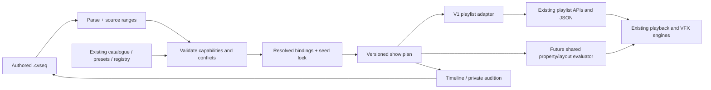

# Playlist Sequence — product and interface design

Proposed feature · 15 November 2026. Read alongside the [language](language-reference.md),
[layout motion](layout-transitions.md) and [delivery plan](implementation-plan.md).

## Purpose

Create a complex, repeatable show as quickly as writing a short set of instructions.
The operator describes the order, duration, composition, transitions and branding;
the builder shows the resulting timeline and lets them audition it privately.
The existing playlist screen remains available. This is another authoring view
of the same playback capabilities, not a replacement application or renderer.

The central interaction follows [SequenceDiagram.org](https://sequencediagram.org/):
edit text and see its visual counterpart, then select something visually to
find the instruction responsible for it. This proposal uses a domain-specific
show language rather than UML notation or that site's implementation.

### Typical tasks

- “An hour of cyan/blue abstract clips, 20 seconds each; alternate my preferred
  4× and 8× looks, smooth transitions, chrome VERSION1 for eight seconds every
  minute; exclude the videos in last night's set.”
- “Hold this video for a minute. Start 4×, zoom into the top pair after eight
  seconds, shrink back after another ten, then show the logo in the lower right.”
- “Use the same sequence with a different colour look and different titles.”
- “Find this awkward change on the timeline, adjust its duration, and try it
  without affecting the Mac.”

## The workspace

Add **Sequence** alongside the existing playlist editing view. Selecting a saved
playlist offers **Open as sequence**; importing creates a new script without
overwriting the playlist. The current playlist UI still loads ordinary compiled
playlists. New capabilities need a supported runtime and a visible capability badge.

```text
┌ Playlist / Sequence     Set name · unsaved       Undo / Redo / Help ┐
│ Mac ownership + engine/output status      [Audition] [Save] [Send] │
├───────────────────────┬───────────────────────────┬────────────────┤
│ SOURCE                │ COMPOSITION · private     │ SELECTED STEP  │
│ line numbers          │ 16:9 output canvas        │ time + duration│
│ autocomplete          │ real engine in production │ clip + crop    │
│ inline diagnostics    │ source 9:16 badge         │ layout/pattern │
│ collapsible sections  │                           │ transition     │
│                       │ play / scrub / time       │ overlay / help │
├───────────────────────┴───────────────────────────┴────────────────┤
│ TIMELINE   Video / Layout motion / Branding / Other VFX            │
│ section markers   clip blocks   transition edges   cue spans       │
├───────────────────────────────────────────────────────────────────┤
│ Library drawer: search + theme / colour / type / exclusions         │
│ bounded shelf, 2 rows; insert reference / reveal used / audition     │
└───────────────────────────────────────────────────────────────────┘
```

The viewport stays focused. The source editor, inspector and library scroll
inside their own bounded regions; the output preview does not grow to the height
of the controls. Inspector groups collapse. Library filters remain visible.
Preview uses a 16:9 output stage; a source thumbnail retains its measured aspect
ratio. No CSS rule stretches portrait footage to fill that stage.

On iPad landscape, source and preview share the width; inspector and library are
drawers. In portrait, **Write / Preview / Timeline** switches panes. The transport,
compile status and remote ownership bar stay visible. A text keyboard may reduce
the preview, not push the live controls below the page. Touch targets are at least
44 CSS px. No essential operation relies on hover or a keyboard shortcut.

### Source and visual edits

- Selecting a source statement highlights its clip/cue in the timeline.
- Selecting a clip, transition or cue reveals its source lines and inspector.
- Inspector edits and timeline drags patch the relevant source tokens; comments,
  aliases and unrelated formatting survive. Show a diff when an edit expands a
  reusable look or generated block.
- Autocomplete comes from the actual media catalogue, transition registry,
  saved layouts and material options. Suggested patterns use the operator's
  featured choices for that layout; **All patterns** remains available.
- Transition suggestions can audition the existing transition preview on focus
  or tap. Respect reduced-motion settings; never trigger Mac playback on focus.
- Missing media, invalid ranges and unsupported engine features have line/column
  diagnostics and actionable fixes. Keep the last successful private build
  visible, explicitly marked **Preview is from revision 12; source has errors**.
- Run cheap syntax/semantic checks after a short typing debounce. Update explicit
  clip previews from the last valid draft; pool regeneration remains a deliberate
  Build/Refresh action so typing cannot silently pick a different set of videos.
- Undo/redo covers text and visual edits in one history. Local draft recovery is
  separate from saving a shared script. Conflict resolution shows revisions.

### Timeline and audition

Video blocks advance the main timeline. Incoming video transitions appear inside
their destination block; layout motion is a labelled span inside a clip. Branding
and VFX use separate lanes to explain time, even when the current engine can only
render one VFX scene at a time. Conflicting lanes are an error, not a suggestion
that multiple independent VFX scenes already work.

Scrub the whole show, zoom to a section, loop a selected range, jump to the next
cue, or preview three seconds either side of a transition. Show the exact current
composition state in the inspector. Seeking rebuilds state from the compiled plan;
it must not depend on which callbacks happened to run earlier. Previewing an
incoming transition needs the outgoing clip as well as the selected clip.

The production audition uses the existing video, transition and 3D engines.
An illustrative still-image design sketch is provided separately and labelled.
Safari's media interaction/proxy requirements still apply; show real preparation
status rather than a black preview with a misleading success message.

## Actions and live safety

| Action | Result |
| --- | --- |
| Build | Validate and resolve a plan locally. Does not send, play or save over anything. |
| Audition | Play the compiled revision privately on this device. |
| Save script | Save source and bindings as a named revision; no live change. |
| Save to playlists | Write compatible compiled entries to the shared playlist store, with source provenance. First save chooses a new name. |
| Send to Mac | Use current remote ownership and the existing playlist command path. Show target, revision and duration. |
| Replace running set | A deliberate live action, never an effect of typing or saving. Offer next-entry or immediate start only when the runtime supports the selected mode. |
| Record | Use the existing real-time recording workflow. Offline/faster-than-real-time export is a separate project. |

There is no second remote-control protocol or separate fullscreen implementation.
The Mac remains authoritative for playout. Losing the iPad connection leaves the
last accepted plan running; reconnect reports the actual revision and playhead.
An offline or unsupported Mac cannot be shown as successfully updated.

## Capability map

“V1 adapter” means representable by current data after a new compiler/editor is
built. It does not mean this language already exists.

| Requested feature | Proposed path | Limit or dependency |
| --- | --- | --- |
| Fixed-duration clips, loops, speed, zoom/pan, fixed 2×/4×/8× layout | V1 adapter | Reuse current entry fields and normalisation. |
| All registered incoming transitions and their parameters | V1 adapter | Query registry; do not duplicate 61 definitions. |
| Timed chrome VERSION1, text and other VFX cues | V1 adapter | One active VFX scene; logo and text use the same scene. |
| Featured patterns and saved looks | Snapshot existing settings/presets into named looks | Explicit pattern IDs make a saved show reproducible. |
| Timed positions for a single logo/text cue | V1 adapter | Existing normalized position, scale, rotation and materials. |
| Smooth 4×↔2× / 8×↔4× within a clip | Shared engine extension | Continuous source clock and interpolated layout geometry. |
| Continuous crop, colour, overlay-position animation | Property-track extension | Not faithfully expressible as a sequence of current cue snapshots. |
| Independent simultaneous logo + title + effect chain | Compositor extension | Current VFX scene switching cannot layer these independently. |
| Arbitrary X/Y/width of a floating video layer | Layer/compositor extension | Different from current source crop pan. |
| Six frames and 24 layout patterns | Layout extension | Requested design capability; current renderer has no six-up mode. |
| Tag queries, similarity, repeats, exact-duration generation | Authoring compiler | Resolve once, store actual choices; draft tags need operator review. |
| Fixed BPM beats and bars | Authoring compiler | Convert deterministically to time. Not live audio tracking. |
| Live beat-following timeline | Clock/sync extension | Do not imply Auto Perform already makes scripted cues beat locked. |

## Architecture and document ownership



The UI never writes a second implementation of crop, transition or 3D rendering.
A compiler and timeline evaluator are new authoring infrastructure; renderer
changes are isolated and shared by V1 and the redesigned route where enabled.
The final implementation must extract/reuse existing behavior without changing
legacy entry semantics. The [plan](implementation-plan.md) identifies that work.

The authored script is the source of truth. The bindings lock records selected
files, durations, pattern choices, seed, catalogue revision and capability set.
The compiled plan records source hash, runtime version and source ranges. Opening
a show does not silently replace a missing video, update tags, or regenerate its
pool. **Refresh selection** previews a diff before changing its bindings.

Importing an existing playlist preserves unknown fields and per-entry cue values.
If a field cannot be expressed, retain its original payload read-only or block
round-trip export with a precise explanation. Never silently omit it. Initial
import is one clip block per entry; automatic pattern simplification is optional
and must prove equivalent timing and values.

## Delivery priorities

1. Source editor, existing-playlist compiler, actual preview and save/load; no
   playback-engine changes. Include logo schedules, pools and reusable looks only
   as their compiler support is ready and tested.
2. A narrow shared engine slice: one video, 4×↔2× and 8×↔4× layout motion. Preserve
   exact legacy endpoints and test real output, recording and iPad control.
3. Animated properties, six-up and multi-layer overlays as separately visible
   capabilities; templates, richer generation and optional AI drafting afterward.

The [full syntax](language-reference.md) describes the intended destination.
The release UI must label unsupported constructs rather than expose controls
whose behavior is only a mockup.
