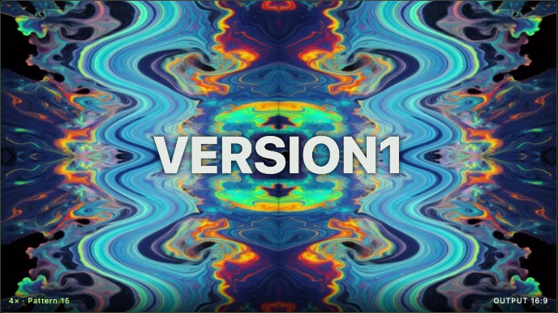
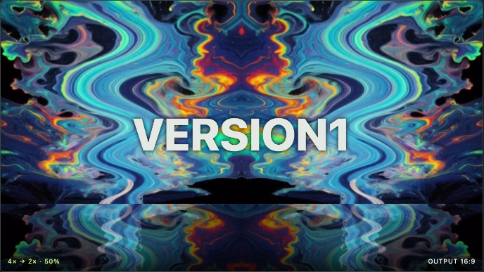
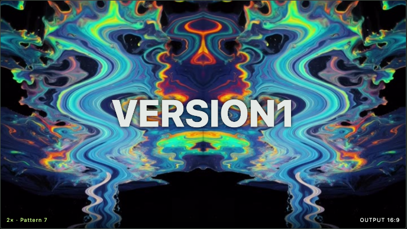

# Continuous layout transitions

Proposed shared-engine addition · no renderer changes made in this design study.

## What the operator sees

Keep one video playing. Change from four mirrored frames to two by expanding a
chosen pair into the output; change back by shrinking those frames into their
original positions and revealing the other two. The zoom/shrink belongs to the
composition, not a new video entry or a stretched source image.

```cvseq
clip liquid for 30s use mirror4 {
  at 8s layout 2x pattern 7 over 1.2s motion zoom-in anchor top-row
  at 18s layout 4x pattern 15 over 1.2s motion zoom-out anchor top-row
}
```

This request is a new capability. V1 currently applies a discrete layout setting.
Splitting the clip into playlist entries is unsuitable: `playEntry()` calls
`showVideo()` and can restart the source. Do not approximate continuous motion by
creating many entries or sending many remote layout commands.

### Still-image storyboard

These frames come from the interactive sketch using a real portrait-library still.
They illustrate a 4×→2× move; they are not captures of an implemented live engine.

| Before · 4× | During · halfway | After · 2× |
| --- | --- | --- |
|  |  |  |

## Coordinates and fixed slots

All tile rectangles use normalized output coordinates, origin top left. Canonical
slot labels belong to the destination grid; persistent animation identities track
which source tiles survive a move. Those concepts must not be conflated.

```text
2×             4×              8×
┌───┬───┐      ┌───┬───┐       ┌───┬───┬───┬───┐
│ 1 │ 2 │      │ 1 │ 2 │       │ 1 │ 2 │ 3 │ 4 │
│   │   │      ├───┼───┤       ├───┼───┼───┼───┤
│   │   │      │ 3 │ 4 │       │ 5 │ 6 │ 7 │ 8 │
└───┴───┘      └───┴───┘       └───┴───┴───┴───┘
```

Mirror-pattern slots never permute. Within a selected layout, tile 1 remains
left of tile 2; four-up keeps 1/2 above 3/4. Animation between layouts has an
explicit mapping; it does not add more orientations to their pattern catalogues.
Keep current IDs: dual has 8 unique patterns, quad 16, eight-up 32. Proposed six-up
needs its own 24-pattern implementation; it cannot be enabled by a UI-only label.

### First supported paths

| Path | Surviving source tiles → target slots | Suggested endpoint patterns | Visual motion |
| --- | --- | --- | --- |
| 4× → 2×, top-row | 1→1, 2→2 | 4× P15 → 2× P7 | Top row expands downward; lower row retires behind it. |
| 2× → 4×, top-row | 1→1, 2→2 | 2× P7 → 4× P15 | Pair shrinks to top row; lower copies appear from same frame. |
| 8× → 4×, left-block | 1→1, 2→2, 5→3, 6→4 | 8× P27 → 4× P15 | Left block expands across the output; right block retires. |
| 4× → 8×, left-block | 1→1, 2→2, 3→5, 4→6 | 4× P15 → 8× P27 | Left block shrinks; right copies enter at their target slots. |

These pattern pairs were checked against the current `CONFIGS`/slot maps: survivor
flip orientations match. Other anchors can be added with equally explicit maps.
For example, a bottom-row 4×→2× maps 3/4 to the target pair. The compiler verifies
that the requested orientation and anchor are compatible rather than changing
the selected pattern behind the operator's back.

First release supports the four paths above. A direct 8×→2× command should offer
an explicit two-stage 8×→4×→2× expansion in the source, with declared durations.
Do not silently insert an intermediate layout. Single-view contains its source
while tiled modes cover their tiles; 1× paths need separate crop acceptance work.

## Geometry, crop and the zoom effect

For top-row 4×→2×, survivor rectangles are:

```text
tile 1: (x=0,   y=0, w=.5, h=.5) → (0,   0, .5, 1)
tile 2: (x=.5,  y=0, w=.5, h=.5) → (.5,  0, .5, 1)
```

For every frame, interpolate geometry with
`p = ease(clamp((showTime - startTime) / duration, 0, 1))`.
Use the source dimensions and existing cover-crop rules to calculate a fresh
isotropic image transform for each interpolated rectangle. Width and height of a
tile may change at different rates; width and height of the source image must
always scale by the same factor. Never independently animate image CSS width
and height to make it fit.

Growing a rectangle alone is not necessarily a camera zoom: for portrait sources,
the 4×→2× height expansion can reveal additional source content. Therefore the
first `zoom-in`/`zoom-out` motion also includes a **zoom accent**: a small uniform
magnification envelope, default 12%, returning to the exact specified endpoint
crop. Its multiplier is `1 + accent * sin(pi * p)`, with accent as a fraction.
The same envelope reverses with the geometry, making the return a shrink/reveal.
Expose 0–40% accent in the inspector and optional `accent 12%` syntax after the
anchor. At 0% this is a pure layout reveal. Keep its meaning separate from a
persistent target crop/zoom change. Do not fake zoom by distorting footage.

Crop focal point defaults to the clip's existing pan; interpolate only if the
script explicitly animates crop. At progress 0 and 1, reuse the exact legacy
geometry/crop result, including pixel rounding. Intermediate rectangles use
fractional coordinates consistently; avoid seams from independently rounded edges.

### Retiring and entering tiles

Survivors stay in front. Retiring copies contract toward their anchor and fade
behind them. Incoming copies use the same decoded video frame and the exact
target flip/crop; they expand/fade into their fixed target slots. Keep a complete
endpoint composition underneath during the move wherever needed to prevent holes.
The implementation must define this background and z-order once, not let canvas
draw order change by frame. Prototype fades are an illustration, not the contract
for source-pixel blending.

At the last frame remove temporary layers and commit the target layout once.
Reverse transitions must arrive at identical crop, positions and orientations,
not a close visual approximation. A repeated 4→2→4 cycle must not accumulate drift.

## Mirror orientation during movement

A horizontal or vertical flip is discrete. Interpolating a scale from +1 to −1
passes through zero and collapses the image. Preferred mappings preserve survivor
flips. If an operator selects incompatible endpoint patterns, the first release
reports a useful diagnostic with compatible choices. A later explicit
`orientation crossfade` option can crossfade two full-size oriented samples;
it must not silently rotate, swap slots or squeeze frames through zero.

Pattern pickers show actual tile geometry and asymmetric orientation marks at a
readable size, plus the stable ID. Featured patterns are read from existing
settings per layout and resolved to concrete IDs when a show is built.

## Time, interruption and synchronization

- The video decoder and source playhead continue through a layout change. One
  source decoder serves all tiles of that clip; repeated draws share its frame.
- Source `speed` changes media time, not the duration of a layout event on the
  show clock. Pause freezes both. Resume continues from the same progress.
- Seek evaluates the clip and all preceding property events at the new time;
  it does not replay timers in order. Scrubbing backward yields the same image.
- First release rejects overlap between layout motion and an incoming video
  transition, and rejects overlapping motions of the same layout property.
  After one completes, the next starts from its exact target.
- A live Next/Stop command cancels pending animation callbacks and releases
  temporary layers. Next starts the next entry's explicit initial state; Stop
  follows existing stop/output behavior. Never let an old tween mutate the next clip.
- The Mac owns live time. Send a resolved event plan, not per-frame commands from
  the iPad. Scheduling, clock anchoring and late-delivery recovery need explicit
  runtime work; clocks from different devices are not interchangeable.
- Reconnection fetches actual clip/event/progress. Late plan acceptance evaluates
  its current state or refuses the stale revision; it does not replay the zoom late.

## Rendering and performance

Use a pure shared geometry/crop evaluator called by private preview, output and
recording paths. Keep current source and 3D rendering code shared. The initial
canvas implementation can draw the union of source/target rectangles; eight↔four
needs a bounded number of temporary draws, with no extra video downloads or
decoders. Profile on the actual gig Mac and iPad: target its normal output frame
rate and publish measurements, not a promise based on the still-image sketch.

If a runtime lacks `layout-motion`, a compatible export must fail with the exact
line and required capability. An operator may explicitly export an alternative
with hard layout cuts; label and save that as a different revision. Never claim
the animated version was sent successfully after discarding its motion.

## Acceptance tests for the engine addition

1. Asymmetric portrait calibration clip, square and landscape clip: no stretching,
   correct crop/focal point at every stage and correct survivor flips.
2. 4 P15→2 P7→4 P15 and 8 P27→4 P15→8 P27: frame-level endpoint parity with current
   modes, continuous source timestamps, no black gaps, no final one-frame jump.
3. Pause/resume, seek in both directions, repeated cycles, Next during movement,
   Stop and reconnect: deterministic state, no stale callbacks or drift.
4. Private preview, Mac window/fullscreen and recorded video agree; original
   non-animated playlists and legacy V1 controls retain their behavior.
5. Incompatible patterns, incoming-transition overlap, unavailable capabilities
   and unsupported six-up have precise diagnostics; no silent fallback.
