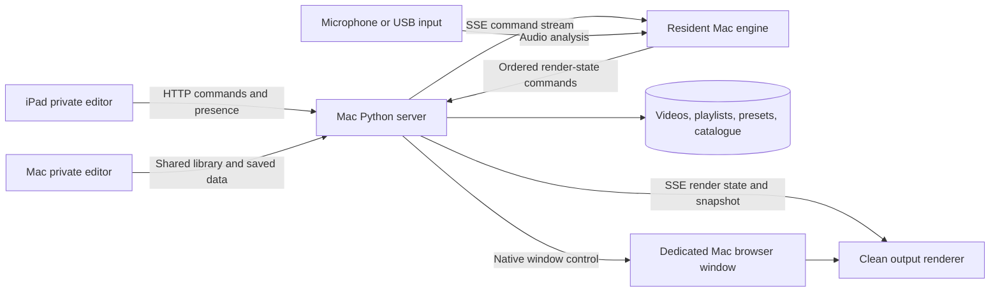

# Club Visuals: technical reference

**Source review: 10 November 2026.** Implementation companion to the
[product reference](product-reference.md) and [UI redesign brief](ui-redesign-reference.md).

## Runtime and repository map

Runtime dependencies are Python 3.10+, `yt-dlp`, FFmpeg and a supported browser.
The Python server uses the standard library; no npm build or Python web
framework is required. FFprobe is used by media integration tests. The desktop
launcher/window controller targets macOS. WebGL2 is required for GPU effects
and the high-definition 3D surface renderer.

| File | Responsibility |
| --- | --- |
| [`server.py`](../server.py) | Threaded HTTP server, explicit routes, source discovery, metadata, downloads, media delivery/conversion, command relay and control ownership. |
| [`index.html`](../index.html) | Main DOM/CSS and most editor logic: transport, layouts, playlists, timeline, cue editor, audio integration, capture and settings. |
| [`remote_control.js`](../remote_control.js) | Sticky toolbar, iPad presence, Mac lock/handover, remote command handling, engine reports and confirmation UI. |
| [`mac_output.py`](../mac_output.py) | Dedicated Chromium profile, loopback DevTools WebSocket and native window open/focus/fullscreen. |
| [`output.html`](../output.html) | Clean program renderer, state replay and resident engine setup frame. |
| [`effects.html`](../effects.html) | Colour/trails controller using its opening editor. |
| [`vfx.html`](../vfx.html) | Scene, mirror, text/logo material and audio controls using its opening editor. |
| [`vfx_engine.js`](../vfx_engine.js) | WebGL scene rendering, live reflections, signed-distance text/logo extrusion, material shading and quality modes. |
| [`transition_engine.js`](../transition_engine.js) | Transition registry, parameter validation, easing, GPU/Canvas rendering and flash preference. |
| [`auto_perform.js`](../auto_perform.js) | Beat/energy/section estimator and performance decisions. |
| [`auto_audio_worklet.js`](../auto_audio_worklet.js) | AudioWorklet feature extraction for the performance engine. |
| [`library_catalog.py`](../library_catalog.py) | Tag validation, atomic catalogue writes, revision checks, bulk transactions and single-level undo. |
| [`library_catalog.js`](../library_catalog.js) | Library filters/order integration and independent per-video review editor. |
| [`tag_manager.js`](../tag_manager.js) | Full classification manager, usage counts, bulk changes and rename/remove/undo flows. |
| [`media_preview.py`](../media_preview.py) | Serialized, cached Safari-compatible H.264/AAC preview preparation. |
| [`start.sh`](../start.sh), [`stop.sh`](../stop.sh) | Server lifecycle on port 8008 and initial editor launch. |
| [`ig-save.sh`](../ig-save.sh) | Standalone CLI downloader into the repository's downloads directory. |
| `assets/` | Version1 artwork and licensed Bungee font. Modern/serif styles also use system-font fallbacks. |

`server.py` explicitly serves known pages/assets; it is not a generic static
site host for every repository file. Markdown documentation is intended for
GitHub or a local Markdown reader.

## Device and rendering architecture



The editor gates its `broadcastState` function: a normal preview does not
publish live render commands. An armed, claimed Mac engine publishes them in
order. Live commands are sent to the current host ID; old hosts and revoked
controller sessions must not take over the show through stale UI.

The output contains a resident `/?host=1` editor frame. Closing its audio setup
panel does not close the frame. The `?monitor=1` output variant skips creation
of another host and output-status reporting, which is useful for isolated
renderer checks. `?managed=1` is the dedicated native-window variant.

The iPad is recognised from Apple touch-device characteristics; `?remote=1`
also explicitly selects controller mode for testing. It stores a controller
ID in sessionStorage and sends heartbeats. The engine has a different ID and
lease. These are operational roles rather than authenticated users.

### Native output window

`MacOutput` searches for Brave, then Chrome, then Edge in `/Applications`.
It starts an app-style window with a dedicated profile under
`.runtime/playout-browser`, using an ephemeral loopback debugging port. The
profile's `DevToolsActivePort` identifies that browser. Only the matching
`/output?managed=1` target is controlled; personal browser profiles are not
attached to or restarted.

`Browser.setWindowBounds` controls fullscreen without the page-level user
activation restriction. Opening/focusing uses `Target.activateTarget` and
preserves window state. The controller reads back the native state before
reporting success. The normal page Fullscreen API remains a separate path.

### Video and graphics

Canvas tiles share a decoded HTML video source. WebGL2 VFX operate on the
composited frame; transition renderers consume the outgoing/incoming
compositions. Scene 6 renders a rounded extrusion from a high-resolution
signed-distance field, using floating-point distance/normal textures,
live-video environment sampling, material lighting and optional supersampling.
It is a specialized text/logo renderer rather than an arbitrary 3D asset loader.

The source composition follows stage size and device-pixel ratio, capped by
the existing texture-size/pixel budget. Quality modes vary sampling workload.
Ordinary recording uses a separate 1920×1080, 30 fps capture canvas.

Safari preview jobs produce H.264/AAC MP4 with fast-start metadata, a maximum
1280-pixel edge and 30 fps. A cache key includes source identity, size,
modification time and preview-version marker. Conversion is serialized to
avoid launching unrestricted concurrent encoders. Source videos are untouched.
Both original and cached media routes support single byte ranges, including
Safari's initial two-byte probe, open-ended ranges and suffix ranges.

## HTTP interfaces

These are local application interfaces, not a versioned public API. URLs with
filenames/slugs must be encoded. The main implementation is in `server.py`.

| Method / route | Purpose |
| --- | --- |
| `GET /`, `/index.html` | Main editor; supports role/query flags. |
| `GET /output` | Clean output; supports managed/monitor flags. |
| `GET /effects`, `/vfx`, `/test` | Controller windows and layout test page. |
| `GET /api/videos` | Current source list, file properties, optional uploader and `catalog` classifications. |
| `GET /video/<filename>` | Original media; 200 or 206 with Content-Range; invalid/unsatisfiable ranges return 416. |
| `GET /thumbnail/<filename>` | Cached/generated JPEG thumbnail. |
| `GET /api/metadata/<filename>` | Instagram sidecar metadata when available. |
| `GET /api/preview/<filename>` | Start/poll a compatible preview job; returns ready URL, pending state or error. |
| `GET /preview-video/<cache-key>.mp4` | Cached compatible media with range support. |
| `POST /download` | Instagram download with event-stream progress. |
| `GET /api/cookie-status`, `POST /api/refresh-cookies` | Cookie status/refresh. |
| `GET /api/config`, `POST /api/config` | Source and clip folder settings. |
| `GET /api/browse?path=...` | Server-side folder browser. |
| `POST /api/library-order` | Save manual filename ordering. |
| `GET /api/library-catalog` | Shared tags, revision and current undo availability/label. |
| `POST /api/library-catalog` | Save one video's validated tags; new clients send `expectedRevision`. |
| `POST /api/library-catalog/manage` | Atomic rename/delete/bulk/review/undo transaction; requires `expectedRevision`. |
| `GET /api/playlists` | Playlist names and slugs. |
| `GET/POST/DELETE /api/playlist/<slug>` | Playlist persistence. |
| `GET/POST /api/video-presets/<filename>` | Named per-video layouts. |
| `DELETE /api/video/<filename>` | Delete a source and associated sidecars/presets/order entry. |
| `POST /api/convert` | Convert browser recordings and profile-specific Instagram captures to MP4. |
| `GET /api/state-stream` | SSE relay for live command/render events. |
| `GET /api/state-snapshot` | Latest retained render-state commands for reconnect. |
| `POST /api/state` | Publish render-state commands. |
| `GET/POST /api/remote-status` | Status aggregation and host/output heartbeat reports. |
| `POST /api/control-session` | Controller heartbeat, explicit claim and release. |
| `POST /api/remote-command` | Send a supported command to the current Mac engine. |
| `POST /api/output-window` | Open/focus or enter/exit native fullscreen. |

### Control and command contracts

Controller ownership expires after about eight seconds without a heartbeat.
Releasing it records the revoked session ID in server memory. Heartbeats alone
cannot reacquire that ID; an explicit claim is required. Mac host reports
normally arrive every two seconds, with a six-second host lease. The UI polls
status roughly every 1.5 seconds.

Remote commands include `take`, `playlist`, `stop`, `next`, `auto`, `hold`,
`lock`, `nextBeat`, `tap`, `resync` and `autoSettings`. Each has a request ID.
The server addresses it to the active host; the engine reports recent
completed/error results so the editor can confirm execution. A missing host,
ownership conflict or expired/revoked controller is an explicit failure.

A `take` carries filename, copied layout, FX, VFX/object/material settings,
trails, caption preference, transition and playback position. A `playlist`
carries a copied playlist object and loop flag. The output receives lower-level
commands such as loadVideo, play/pause, seek, setView, setConfig, setSpeed,
setZoom, setPan, setEffects, setTrails and VFX/shape/logo updates.

Render snapshots exclude transient commands such as a pulse or a one-time
remote action. Transport state is consolidated and old seek state is cleared
on a new load. Snapshot replay is not an engine recovery journal or continuous
playhead synchronization.

### Classification transactions

Single-video editing accepts themes/colours/types arrays, notes and Reviewed.
Tag limits are 12/category and 40 characters/tag; notes are limited to 300.
Case-insensitive duplicates are removed, and existing vocabulary spelling is
reused when adding an equivalent label.

Manager requests have one of these shapes, plus `expectedRevision`:

```json
{"action":"rename","field":"themes","tag":"Portrait","newTag":"People"}
{"action":"delete","field":"colours","tag":"Purple"}
{"action":"bulk","mode":"add","field":"types","tag":"3D animation","filenames":["clip.mp4"]}
{"action":"review","reviewed":true,"filenames":["clip.mp4"]}
{"action":"undo"}
```

The examples are separate requests. Rename/delete target assignments in the
current source library. Bulk/review require explicit existing filenames.
Validation completes before one atomic file replacement; a partially valid
bulk request does not partially save. A conflict returns JSON with HTTP 409.
Single-video legacy clients may omit the revision for compatibility; the new
review UI always supplies it. Undo stores one before-image in server memory
and is replaced by the next successful edit.

## Persistence and backup

| Location | Contents | Shared between devices? | In Git by default? |
| --- | --- | --- | --- |
| Configured source directory | MP4s and optional `.info.json` sidecars | Served by Mac | No for default downloads; external directories are outside the repo |
| `thumbnails/` | JPEG cache | Served by Mac | No |
| `playlists/<slug>.json` | Named sequences and effect cues | Yes | No |
| `video_presets/<filename-hash>.json` | Per-video named layout copies | Yes | No |
| `library_order.json` | Manual filename order | Yes | No |
| `library_catalog.json` | Tags, notes, review flags and revision | Yes | No |
| `config.json` | Source/clip paths | Yes | No |
| `.cookies.txt` | Exported authentication cookies | Server use only | No |
| `.runtime/ipad-previews/` | Regenerable H.264/AAC proxies | Served by Mac | No |
| `.runtime/playout-browser/` | Dedicated browser profile and DevTools port file | Mac use only | No |
| Browser localStorage | Auto curation, named text lists, input/profile/pool choices, preview aspect, flash preference | Per origin/profile | No |
| Browser sessionStorage | Controller session identity | Per tab session | No |
| Server memory | Ownership/leases, snapshots, command results and last tag undo | Current running server | No |

GitHub source backups do not back up the personal library or classification
data. Back up the source media and shared JSON/directories together when
migrating installations. Filename identity connects media, classifications,
layouts and playlist references; a future rename feature needs a coordinated
metadata migration.

A minimal catalogue file is:

```json
{
  "version": 1,
  "revision": 3,
  "videos": {
    "clip.mp4": {
      "themes": ["Geometric"],
      "colours": ["Blue"],
      "types": ["3D animation"],
      "notes": "Good opening look",
      "reviewed": true,
      "source": "manual"
    }
  }
}
```

Older catalogue files without `revision` load as revision zero. The next save
writes the revision; existing label data is retained.

A representative playlist entry is:

```json
{
  "video": "clip.mp4",
  "view": "dual",
  "preset": 5,
  "loopMode": 1,
  "speed": 1,
  "zoom": 1.2,
  "panX": 0,
  "panY": 0,
  "duration": {"type": "seconds", "value": 12},
  "transition": {"type": "cross-dissolve", "duration": 0.8, "pace": "steady", "seed": 1, "params": {}},
  "cues": [{"at": 0, "effect": "text", "text": "VERSION1", "skin": "chrome", "font": "modern", "quality": "high"}]
}
```

The normalizers supply omitted cue/material defaults. Saved view IDs are
`single`, `dual`, `triple`, `quad`, `octo`; UI names are Single, Dual, 3x, 4x,
8x. Playback modes are 0 Once, 1 Loop and 2 Bounce. Transition IDs, scene IDs
and object/cue field names should remain stable through a UI redesign.

## Running and checking the app

```sh
./start.sh
./stop.sh
```

The server listens on `0.0.0.0:8008` and must be reachable over the local
network. The launcher uses `lsof`, starts Python, writes `.server.pid`, logs to
`/private/tmp/club_visuals_server.log` and opens the editor. Restart/reload is
needed after server-code changes. A running page must be reloaded to load new
JavaScript, including the resident Mac output/engine after renderer changes.

Use the targeted automated checks:

```sh
python3 -m pytest -q test_instagram_loop.py test_library_order.py test_library_catalog.py test_media_preview.py test_remote_control.py
node test_transition_engine.js
node test_vfx_surface.js
node scripts/generate-transition-reference.js
```

Pytest is a test dependency, not a runtime server dependency. Tests bind
temporary loopback ports and use FFmpeg/FFprobe for real conversion checks.
`test_server.py` is an older standalone smoke runner with source-string
assertions; review those assertions before making it a redesign acceptance
gate. `test_layouts.html` is a manual layout test surface.

Browser verification should cover real clips and separate preview/output
windows, iPad-sized viewports, the fullscreen native-window round trip,
ownership loss/reacquisition, classification save/undo/conflict, every material
and a GPU fallback. Use a copied catalogue for destructive/rename smoke tests.
Desktop touch/UA emulation does not replace checking physical iPad playback,
audio hardware or a venue projector.

## Boundaries and extension work

The server assumes a trusted local network and has no application login,
role authentication, cloud data store or public deployment configuration.
DevTools access is loopback-only, but the server's own local HTTP actions are
not an internet-facing service contract.

Several planned capabilities are not implemented: beat/bar transition timing,
effect chains/weighted collections, offline predictive audio analysis, editable
performance replay, arbitrary 3D mesh import and independent output routing.
See the planning documents for proposals, and the product reference for known
current mismatches such as clean-output Bounce and editor-local recording.
