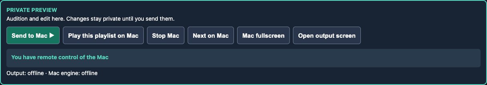
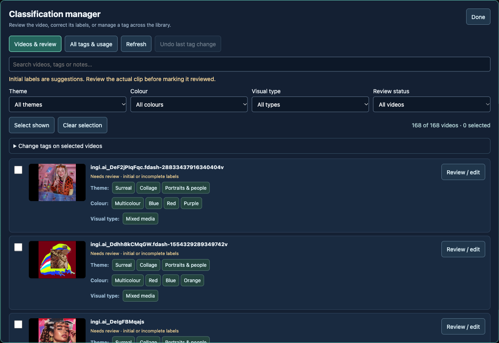
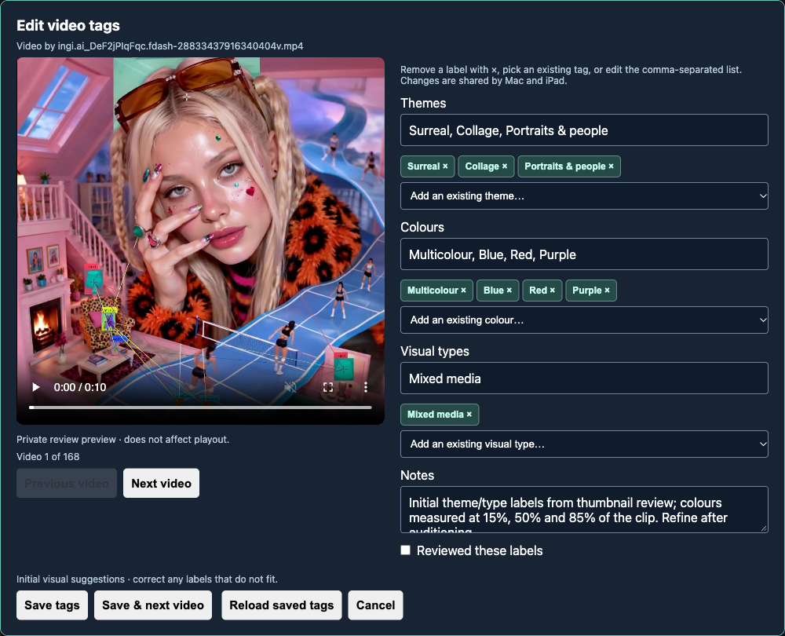
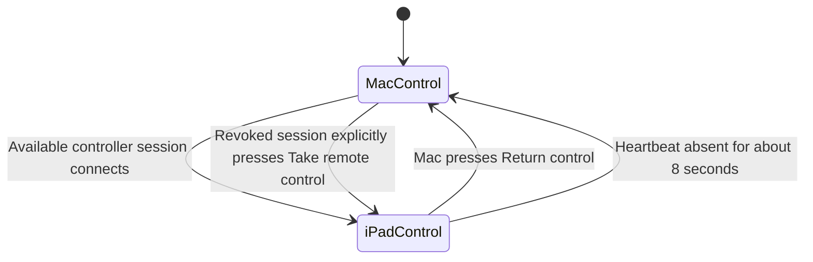

# Club Visuals: UI redesign reference

**Source review: 10 November 2026.** This is the behaviour-preservation brief
for a new interface, not a proposal to implement every possible improvement.
Use the [product reference](product-reference.md) for feature explanations and
the [technical reference](technical-reference.md) for implementation contracts.

## Product concepts the design must make visible

The operator prepares a private composition, deliberately sends a look or
playlist to the Mac, and may continue preparing while that show runs. The
library, classification vocabulary, saved layouts and playlists are separate
objects. Auto Perform is a live musical decision engine, while Auto playlist
generation creates an editable sequence in advance.

The main distinctions should be legible without opening Settings:

| Distinction | Required meaning |
| --- | --- |
| Preview / Mac playout | Which image is being edited and which image an audience sees. |
| Device ownership / engine connection | Who may send commands versus whether the Mac can execute them. |
| Current editor / saved file / sent copy | A local change, a persisted edit and a live transferred playlist are different states. |
| Classification / performance curation | Shared themes/colours/types versus browser-local exclusion and Calm/Medium/Peak energy. |
| Video look / saved layout | The complete FX/VFX look versus the narrower per-video layout/playback preset. |
| Transition / timed VFX cue | The effect between clips versus effects scheduled within an entry. |
| Preview recording / live recording | Record captures its own editor. Remote Mac recording is not implemented. |

There is currently no dedicated iPad live-program monitor panel. The visible
iPad video is the preparation preview. A future design showing both needs a
separate program-monitor implementation rather than relabelling that preview.

## Current screen inventory

This table describes the present arrangement so every surface can be accounted
for when navigation changes. Source references are relative to the repository.

| Surface | Present entry point / contents | State or scope | Main source |
| --- | --- | --- | --- |
| Remote toolbar | Sticky first section; Send to Mac, Mac playlist, Stop, Next, fullscreen, Open output, connection/command status | Live commands and ownership | `remote_control.js` |
| Handover banner/dialog | Being remote controlled; Return control to Mac; Open output | Mac lock and recovery | `remote_control.js` |
| Connection panel | Cookie age/freshness, refresh with/without optional keychain password | Server download authentication | `index.html`, `server.py` |
| Download bar | Instagram URL, Download, streaming status | Server filesystem work | `index.html`, `server.py` |
| Sound to Visuals | Mac audio input, Auto Perform, profile, interval, pool, holds, tempo/resync, meter/status | Mac performance | `index.html`, `remote_control.js`, `auto_perform.js` |
| Auto Perform text lists | List selector, entries, type/value/enabled, Show now, copy/rename/delete | Browser-local lists copied at remote start | `index.html` |
| Curate videos dialog | Search, include/exclude and energy for each video | Browser-local performance curation | `index.html` |
| Preview player | Video/composited image, position/progress, transport, layout, mirror, zoom/pan, captions | Private editor | `index.html` |
| Preview effect controls | FX, VFX, Mirror 3D, 3D Logo, 3D Text | Private editor; opens controller windows | `index.html` |
| Saved layout panel | Generated/custom name, save, load, delete, quick add | Per-video persisted layouts | `index.html`, `server.py` |
| Library | Thumbnails, filenames, tags, filters, ordering, delete, Add to playlist | Shared media/metadata; preview selection | `index.html`, `library_catalog.js` |
| Classification manager | Videos & review; All tags & usage; bulk changes; Undo | Shared catalogue | `tag_manager.js`, `library_catalog.py` |
| Tag review editor | Independent player, category chips/pickers/fields, notes, Reviewed, queue navigation, Save/Next | Shared tags and local review video | `library_catalog.js` |
| Playlist workspace | Library side column, central preview/timeline, right inspector/palette/playlist tools | Private sequence preparation | `index.html` |
| Transition audition | Clip pair, effect, duration, pace, parameters, replay, apply | Isolated preview | `index.html`, `transition_engine.js` |
| Script effects dialog | Time, effect, text/shape/material/rotation parameters | Cues in a playlist entry | `index.html` |
| Quick Add to playlist | Existing/new playlist, duration, transition, Add | Persists immediately | `index.html` |
| Instagram clip panel | Crop rectangle, format, start, duration, overlap transition, capture/download | Local editor capture + server conversion | `index.html`, `server.py` |
| FX window | Colour sliders/presets, transport shortcuts and trails | Calls its opening editor | `effects.html` |
| VFX window | Scene/pulse, reflection/3D controls, input/sensitivity | Calls its opening editor | `vfx.html` |
| Settings | Source folder browser, clip folder browser/inheritance, Reduce flashes | Server folders + browser preference | `index.html`, `server.py` |
| Clean output | Audience image; windowed fullscreen/audio setup HUD | Live rendering | `output.html` |
| Mac audio setup | Embedded resident engine, source/input controls, close setup | Keep engine alive when setup closes | `output.html`, `index.html?host=1` |

Today Library/Playlist/Settings are tabs in the right column. Playlist mode
moves the Library into a dedicated side column and exposes the timeline and
selected-clip inspector. FX and VFX are pop-out windows rather than main-app
panels. Their placement can change, but their connection to the opening editor
must remain explicit.

### Current screenshots

These captures show the current implementation, rather than a proposed redesign.
The toolbar example deliberately shows output/engine offline while ownership
belongs to the iPad.

## Action-scope matrix

Use this matrix when assigning button labels, colours and confirmation/status
treatments. A “save” operation and a “go live” operation must not look identical.

| Action | Changes preview | Changes Mac playout | Persists data |
| --- | --- | --- | --- |
| Pick library clip / change layout / seek / Play preview | Yes | No | No |
| Edit FX/VFX/material | Yes | No until sent | Only when copied into a saved playlist cue |
| Save video layout | Leaves current look | No | Per-video layout file |
| Save playlist | Leaves current preview | Does not update already sent copy | Playlist JSON |
| Add through quick playlist dialog | No requirement to play it | No | Playlist immediately |
| Edit/review/rename/remove classification tags | Review player only, if opened | No | Shared catalogue |
| Filter/sort library | Changes visible list | No | Manual order is left intact |
| Send to Mac | Leaves the prepared look | Replaces live look; starts playback | Current live command snapshot is in memory |
| Play this playlist on Mac | Leaves editable copy | Starts a transferred copy | Not an automatic Save of the editor playlist |
| Next / Stop Mac | No requirement to change preview | Yes | No saved playlist rewrite |
| Open output | No | Opens/focuses window; preserves fullscreen | Dedicated browser profile exists locally |
| Mac fullscreen | No | Changes native output-window mode | No |
| Preview fullscreen | Changes this editor's presentation | No | No |
| Mac Auto Perform / holds / tempo controls | Preview remains separate | Yes | Some preferences are browser-local |
| Record / Instagram clip | Captures this editor | Does not initiate remote recording | MP4 written by server |
| Change folder | Library/content discovery may change | Does not move existing source files | Server config |

## Ownership and connection states

The diagram is about command ownership, not the lifetime of a running show.
The engine can keep playing during controller loss. A revoked session must
not silently reclaim ownership on its next heartbeat. Reloading the same iPad
tab preserves its session ID. Ownership is not an account/authentication model.

The interface needs separate displays for:

- **Ownership:** this controller owns control, another controller owns it,
  control returned to Mac, or connection unknown.
- **Mac engine:** connected, not connected, or another engine already holds
  the active lease.
- **Output window:** closed/offline, windowed or fullscreen.
- **Command:** preparing the engine, sent, confirmed, failed or unconfirmed.

On the Mac, dimming alone is insufficient: controls and shortcuts are made
inert and the server also validates command ownership. Return control and Open
output remain reachable. When a modal is open, a dedicated handover dialog
sits above it so the browser's focus trap cannot hide the recovery action.
Returning control restores the underlying editor without discarding its form.

## Core workflows to preserve

### Prepare a look while a show continues

1. Browse/filter the library and choose a clip.
2. Play/seek it in private preview; choose layout, speed, mirror, crop and FX.
3. Choose text/logo and a material if needed.
4. Send to Mac deliberately; show confirmation or failure.
5. Continue editing another look without changing the one playing.

### Correct a misclassification

1. Open Manage classification tags; filter/search the suspect group.
2. Review / edit a clip, with the actual video alongside the tags.
3. Remove incorrect chips and add existing/custom labels.
4. Decide whether the whole classification is Reviewed.
5. Save or Save & next; update counts and filters from saved data.
6. For a vocabulary-wide mistake, inspect the tag's assignments, rename/merge
   it or remove it with the affected count shown. Provide Undo.

A tag edit must never switch the main preview, change the show, or delete media.
If another screen saved meanwhile, preserve the user's draft and explain how
to reload/reconcile it. The tag manager has its own video player and decoding
lifecycle; close it cleanly when review ends.

### Build and perform a playlist

1. Choose/load/create a playlist and identify whether edits are saved.
2. Add library clips, a saved layout or the current prepared view.
3. Set duration, incoming transition and optional timed effect cues.
4. Scrub the timeline and audition transitions independently.
5. Save if a persistent playlist is wanted.
6. Play locally to audition or send the sequence to the Mac to perform.
7. Next/Stop operate on the explicitly labelled destination.

### Start audio-reactive performance

1. Establish Mac microphone/USB permission and input once during setup.
2. Choose profile, interval, library/playlist pool and curation.
3. Start Mac Auto Perform; show listening/tempo-confidence status.
4. Use holds, Next on beat, Tap tempo and Resync while it runs.
5. Stop without pretending the current look was cleared or the audio feed was
   played through the app.

### Capture content for reuse

1. Distinguish Record current editor from Instagram clip capture.
2. For a clip, set frame ratio/crop, source start, finished duration and overlap.
3. Show capture, stopping, conversion and error states separately.
4. Offer the finished file and its destination.

## Control reference for layout work

The following are current UI ranges, not a recommendation that every slider
must remain visible at all times.

| Area | Controls / range |
| --- | --- |
| Playback | Once, Loop, Bounce; speed 0.25×–2× by 0.25; mute; seek |
| Composition | Single/Dual/3x/4x/8x; preset 1–32; zoom 1–4; X/Y pan −1 to 1 |
| Transition | 61 choices; duration 0.15–10 seconds; Even/Build/Hit/Ease; effect-specific parameters |
| Colour FX | Hue 0–360°; saturation 0–300%; contrast/brightness 50–200%; blur 0–10 px; invert/sepia 0–100% |
| VFX | Seven scenes; intensity 0–2; feedback 0–0.96; pulse; input and sensitivity |
| Mirror sculpture | Text/alpha image; X/Y, scale, reflection depth, edge glow, angle, extrusion, motion |
| 3D object | Logo/text; three typefaces; nine finishes; X/Y, size, depth; X/Y/Z rotation and auto-axis/sweep |
| 3D material | Bevel 0–0.1; roughness 0.025–0.8; reflection/wrap 0–2; brightness 0.3–2; Balanced/High/Ultra |
| Auto Perform | Four profiles; changes every 4/8/16 bars; two pool choices; holds, next beat, tap and resync |
| Classification | Up to 12 tags per category; each 1–40 characters; notes up to 300 characters; Reviewed boolean |
| Capture | 4:5, 9:16 or 1:1; finished duration 0.1–600 seconds; overlap 0.1–10 seconds, at most half the finished duration |

3D settings are shared by the logo and text renderer. Mirror sculpture is a
different scene with its own controls. The current scene selector calls scene
6 “3D Version1 logo” even when it contains text; a redesign can use a clearer
shared branding label without changing the saved scene ID.

## Responsive, input and accessibility requirements

- Keep live actions and command/ownership status visible while the iPad page
  scrolls. Account for safe-area insets and Safari chrome.
- Account for the toolbar height when scrolling a selected clip into view, so
  pinned controls do not obscure its preview or heading.
- Keep the video usable in iPad landscape and portrait; avoid requiring a
  desktop-sized right sidebar to reach Play, Send or Stop.
- Use distinct, persistent labels for Preview fullscreen and Mac fullscreen.
- Provide touch-sized primary controls. Some current tag chips are compact;
  their redesign should improve touch targets rather than copying their size.
- Retain keyboard operation and visible focus. Review dialogs and pop-outs
  must not consume performance keys while the operator types text.
- Preserve non-drag alternatives such as Add to playlist and drag-handle arrow
  keys. Do not assume desktop HTML drag-and-drop is reliable on every iPad.
- Show loading/preparing state before a Safari-compatible proxy is available.
  Do not present an empty black player as if the clip were ready.
- Preserve a usable recovery action above dialogs when remote ownership changes.
- Separate errors from status: an unconfirmed command is not a confirmed success.

## Data and visual hierarchy

Suggested priorities for a new design, rather than implemented new navigation:

1. **Performance status:** owner, Mac connection, live clip/playlist, Stop.
2. **Preparation:** the video, common transport, composition and deliberate send.
3. **Content:** library, classification review and playlists.
4. **Creative depth:** transition tuning, colour FX, VFX/material controls and cues.
5. **Setup/maintenance:** authentication, folders, input permission and diagnostics.

Preserve contextual controls while reducing the current density of sliders.
Do not hide which destination a control affects. Keep server-persisted edits
distinct from local preferences and from unsaved preview state.

## Current gaps to carry into planning

| Gap | Design implication |
| --- | --- |
| No remote live Pause/Resume or Record | Adding those buttons requires command/engine work, not just rearranging existing HTML. |
| Clean output Bounce currently becomes forward looping | Treat corrected parity as a separate implementation item and test it. |
| One engine lease; latest-command reconnect | Do not promise seamless show recovery after server/browser restart. |
| Browser-local text lists, curation and flash preference | Do not show a universal Saved/shared badge for all settings. |
| FX/VFX rely on opener windows | An inline inspector must replace that integration, not leave stale window references. |
| Initial classifications are fallible and new clips are untagged | Keep review/correction first-class; do not imply automatic accuracy. |
| Current recordings belong to their initiating editor | Distinguish their destination from live Mac playout. |
| Historical screenshots predate recent work | Use current running UI and this inventory as the baseline. |

## Redesign acceptance checklist

- [ ] Prepare/edit/audition without interrupting a look already playing on Mac.
- [ ] Send a complete look including material settings and confirm execution.
- [ ] Send an unsaved playlist copy; distinguish it from disk Save and local Play.
- [ ] Run a playlist after the controller sleeps or disconnects.
- [ ] Recover Mac ownership from both a normal page and an open modal.
- [ ] Require explicit reacquisition by a revoked iPad session.
- [ ] Open/focus output without changing fullscreen; enter/exit fullscreen remotely.
- [ ] Show first-use Safari proxy work, playback errors and disconnected states.
- [ ] Combine Library filters and restore manual order without rewriting it.
- [ ] Review a clip independently; correct tags; Save & next; preserve notes.
- [ ] Rename/merge/remove tags with usage counts and working Undo.
- [ ] Reject stale concurrent edits and prevent partially applied bulk changes.
- [ ] Preserve layout copies, playlist durations, transitions, cues and material round trips.
- [ ] Keep Mac audio ownership, microphone setup and live decision status clear.
- [ ] Capture editor recordings and Instagram loops with accurate destination/status.
- [ ] Test touch, keyboard, empty library, missing media, unavailable GPU and reduced-flash mode.
